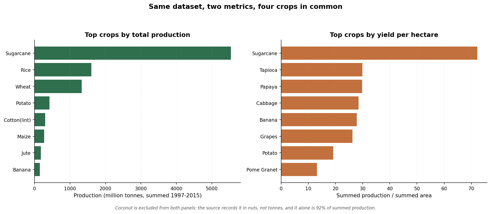

# Sustainable Farming Impact Dashboard

Cleans and analyses crop production data to rank crops by **yield efficiency** —
production per hectare rather than raw totals.



## Why yield per hectare

Production totals favour crops grown on more land. Dividing production by area
gives a like-for-like comparison, so a small high-efficiency crop is not buried
under a large low-efficiency one. The chart above is the argument: the two
rankings share only four crops out of ten.

## Findings

From 238,838 rows covering 106 crops, 33 states and the years 1997–2015:

1. **Total production and yield per hectare disagree almost completely.** Only
   4 of the top 10 crops appear in both lists — Sugarcane, Potato, Jute, Banana.
2. **Coarse cereals look large and yield badly.** Among the top 20 crops by
   production, Jowar ranks 11th for volume but 69th for yield, Bajra 10th and
   67th, Arhar/Tur 19th and 79th. Bulk does not imply efficiency.
3. **Sugarcane is the only crop in the top three on both metrics** (1st by
   production, 1st by yield at 72.2 units per hectare), which is why it dominates
   any single-metric chart.
4. **2011 was the highest-production year** in the period, but that partly
   reflects which crops were planted that year, not efficiency.
5. **The headline number is a data artifact.** Coconut alone is 92.1% of summed
   production because the source records it in nuts, not tonnes. Every ranking in
   this repository excludes it for that reason — see Data caveats.

## Data caveats

Stated plainly, because a chart without them is misleading:

- **The `production` column is not one unit.** It is tonnes for most crops and
  nuts for Coconut. Cross-crop production totals are not physically meaningful;
  within-crop comparisons are.
- **35 rows share the same (state, district, year, season, crop) key but differ
  in value.** They are kept, because the source offers no way to determine which
  duplicate is correct. Dropping them would silently invent an answer.
- **Yield per hectare here is summed production divided by summed area** across
  all years, not an annual average. It ranks crops; it is not an agronomic
  measurement.

## Project structure

```
sustainable-farming-impact-dashboard/
├── scripts/
│   ├── data_cleaning.py       # cleaning pipeline: raw -> processed
│   └── report.py              # prints findings, regenerates the chart
├── data/
│   ├── raw/                   # source dataset goes here (not committed)
│   └── processed/             # cleaned output (not committed)
├── docs/
│   └── top_crops.png          # generated chart used above
├── requirements.txt
├── LICENSE
├── .gitignore
└── README.md
```

## How to run

1. Clone the repo and enter the folder:

   ```bash
   git clone https://github.com/sssfullstack007/sustainable-farming-impact-dashboard.git
   cd sustainable-farming-impact-dashboard
   ```

2. Install dependencies:

   ```bash
   py -m pip install -r requirements.txt
   ```

3. Put the source dataset in `data/raw/` under its original name,
   `Crop Production data.csv`. It is not committed because it is 18 MB.

4. Clean the data:

   ```bash
   py scripts/data_cleaning.py
   ```

   Expected output:

   ```
   Loaded 238,838 rows and 8 columns
   Removed 0 invalid rows, kept 238,838
   Saved cleaned data to 'data\processed\crop_production_clean.csv'
     season: 8 distinct raw values -> 6 after stripping
     state_name: 34 distinct raw values -> 33 after stripping
   ```

5. Print the findings and rebuild the chart:

   ```bash
   py scripts/report.py
   ```

The pipeline never modifies the raw file, so it can be re-run safely.

## What the code actually does

`scripts/data_cleaning.py`

- Standardizes column names: lowercase, spaces to underscores
- **Strips padded whitespace from text values.** The raw file contains
  `"Kharif     "`, `"Kharif   "` and `"TELANGANA "` alongside their clean forms.
  Left alone, one season becomes eight and one state becomes two.
- Validates that `area` and `production` exist, failing with a clear message if not
- Drops rows missing `area` or `production`
- Removes zero and negative area/production values
- Adds `yield_per_hectare = production / area`
- Writes to a separate processed file, creating folders as needed

The validation steps currently remove no rows: the source file has no missing or
non-positive values. They exist so the pipeline fails loudly if the source
changes, rather than producing quietly wrong output.

`scripts/report.py`

- Groups by crop to build both rankings
- Excludes Coconut from comparisons, since its unit is not comparable
- Measures the agreement between the two rankings rather than asserting one
- Writes `docs/top_crops.png` with matplotlib

Anything not implemented in code is not claimed here.

## Skills demonstrated

Python, pandas, matplotlib, data cleaning, reproducibility, honest reporting of
data limitations, Git.

## License

MIT — see [LICENSE](LICENSE).
